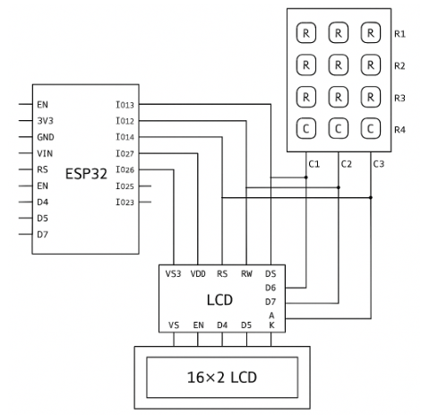
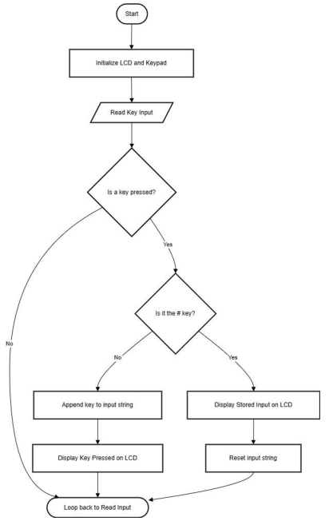
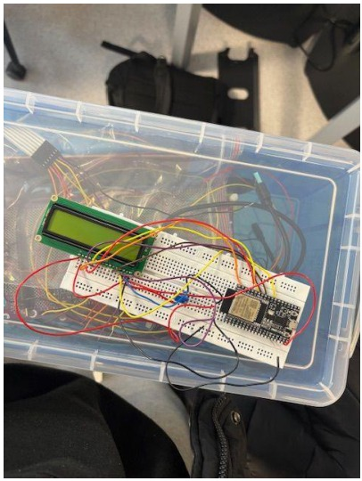
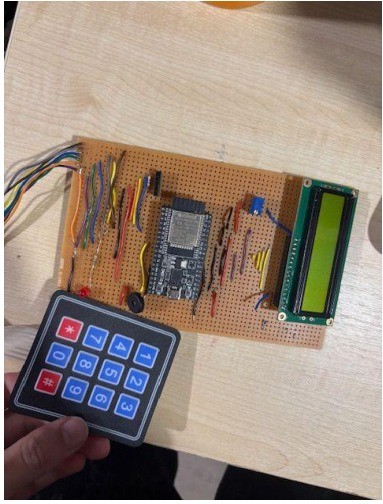

# ESP32 Keypad and LCD Interface

Development and testing of a keypad and LCD interface using an ESP32 microcontroller, a 4×3 matrix keypad and a 16×2 character LCD.

The project demonstrates digital input processing, character display, input storage and command confirmation using Arduino C++.

Developed as part of an Electrical and Electronic Engineering laboratory project.

## Demo / Images

### Keypad and LCD Circuit Schematic

Original Fritzing schematic showing the ESP32 connections to the matrix keypad and 16×2 LCD.

### Keypad Input Flowchart

Original laboratory flowchart illustrating keypad input detection, character storage, LCD feedback and confirmation.

### Breadboard Prototype

Photograph of the initial keypad and LCD circuit assembled on a breadboard.

### Stripboard Construction

Photograph showing the physical implementation of the keypad and LCD interface on stripboard.

Additional images and descriptions are available in the [Project Documentation](docs/README.md).

## Hardware

- ESP32 development board
- 4×3 matrix keypad
- 16×2 character LCD
- Breadboard
- Stripboard
- Jumper wires
- Connecting cables
- Power supply
- USB cable for programming

## Pin Configuration

### LCD Connections

| LCD Signal | ESP32 GPIO |
|---|---|
| RS | GPIO4 |
| Enable | GPIO5 |
| D4 | GPIO18 |
| D5 | GPIO19 |
| D6 | GPIO21 |
| D7 | GPIO23 |

The LCD uses a 4-bit parallel interface to reduce the number of microcontroller pins required.

### Keypad Connections

| Keypad Connection | ESP32 GPIO |
|---|---|
| Row 1 | GPIO13 |
| Row 2 | GPIO12 |
| Row 3 | GPIO14 |
| Row 4 | GPIO27 |
| Column 1 | GPIO26 |
| Column 2 | GPIO25 |
| Column 3 | GPIO33 |

These pin assignments are taken from the keypad and LCD implementation documented in the laboratory report.

**Hardware note:** GPIO12 is a boot-strapping pin on the original ESP32, so external circuitry must not interfere with its required startup state.

## How It Works

The ESP32 reads input from a 4×3 matrix keypad and processes the entered characters.

The LCD displays feedback, while a string variable stores the sequence of inputs until the user presses the confirmation key.

### 1. Matrix Keypad Input

The keypad contains 12 keys arranged in four rows and three columns.

The ESP32 detects keypresses through the row and column connections using the Keypad library.

Each detected key is processed by the Arduino program.

### 2. LCD Display

The 16×2 LCD displays up to 16 characters on each of its two rows.

The LiquidCrystal library is used to control the display through the ESP32's digital GPIO connections.

When a key is pressed, the LCD updates to show the entered character.

### 3. Character Storage

Each keypad character is added to a string variable.

This allows the program to retain a sequence of user inputs until confirmation.

### 4. Input Confirmation

The `#` key acts as the confirmation button.

When pressed, the program:

1. Outputs the stored sequence to the Serial Monitor.
2. Displays the stored input on the LCD.
3. Clears the stored string.
4. Continues accepting new keypad inputs.

## System Operation

The interface follows this sequence:

1. Initialise the ESP32 and LCD.
2. Initialise the matrix keypad.
3. Wait for a keypress.
4. Detect the pressed character.
5. If the key is not `#`, store and display it.
6. If the key is `#`, display and submit the stored input.
7. Clear the stored sequence.
8. Repeat the process.

## Software

### Development Environment

- Arduino IDE
- Arduino C++
- ESP32 board support package
- Keypad library (`Keypad.h`)
- LiquidCrystal library (`LiquidCrystal.h`)

### Project Files

| File | Description |
|---|---|
| `keypad-lcd-interface.ino` | Arduino code for keypad input, LCD output and input confirmation |
| `docs/README.md` | Original schematic, flowchart, photographs and laboratory documentation |

The Arduino sketch is based on the successfully tested keypad and LCD interface from Week 7 of the laboratory report.

## Build & Test

### 1. Hardware Assembly

1. Connect the keypad rows to GPIO13, GPIO12, GPIO14 and GPIO27.
2. Connect the keypad columns to GPIO26, GPIO25 and GPIO33.
3. Connect the LCD control pins to GPIO4 and GPIO5.
4. Connect the LCD data pins to GPIO18, GPIO19, GPIO21 and GPIO23.
5. Connect the LCD power, ground and contrast circuitry according to the original schematic.
6. Verify all connections before applying power.

### 2. Programming

1. Open `keypad-lcd-interface.ino` in Arduino IDE.
2. Install the Keypad and LiquidCrystal libraries if required.
3. Select the correct ESP32 board and serial port.
4. Upload the sketch.
5. Open the Serial Monitor at 115200 baud.

### 3. Testing

1. Press an individual keypad key.
2. Confirm that the correct character appears on the LCD.
3. Enter multiple characters.
4. Press `#` to confirm the stored input.
5. Check the completed sequence on the LCD.
6. Confirm that the sequence is printed to the Serial Monitor.
7. Enter another sequence to verify that the stored input was cleared.

## Results / Notes

### Successful Implementation

The laboratory project demonstrated:

- Successful detection of keypad inputs.
- Character display on a 16×2 LCD.
- Storage of multiple keypad characters.
- Input confirmation using the `#` key.
- Serial Monitor output for verification.
- Breadboard and stripboard construction.

The keypad and LCD system was successfully demonstrated during initial laboratory testing.

### Observations

The Keypad library successfully detected user inputs, and the LiquidCrystal library provided real-time display feedback.

The input-storage and confirmation logic allowed users to enter and submit complete character sequences.

### Limitations

The interface was originally developed as part of a larger command-based robot navigation project.

Although the standalone keypad and LCD functionality worked successfully during initial testing, hardware problems later prevented its integration into the complete maze-navigation system.

The complete command-based robot navigation system was therefore not successfully implemented.

### Future Improvements

- Add input validation.
- Implement a clear or delete function.
- Improve long-string handling on the 16×2 LCD.
- Develop a structured menu system.
- Implement a finite-state machine for command processing.
- Rebuild and verify the hardware connections before integrating the interface into a robot.

## What I Learned

- How to interface a matrix keypad with an ESP32 microcontroller.
- How to process digital keypad inputs using Arduino C++.
- How to control a character LCD using a 4-bit parallel interface.
- How to store and manipulate user input strings.
- How to implement confirmation logic.
- How to use the Serial Monitor for testing and debugging.
- How to construct circuits on breadboard and stripboard.
- Why hardware reliability matters when integrating embedded subsystems.

## Related Projects

This project forms part of a series of embedded systems and robotics laboratory projects:

- [EEEbot Robot Construction](https://github.com/farazali-24/eeebot-robot-construction)
- [ESP32 Wireless Joystick Robot Control](https://github.com/farazali-24/esp32-wireless-robot-control)

## Credits

Developed as part of an Electrical and Electronic Engineering laboratory project.

**Hardware:**
- ESP32 microcontroller
- 4×3 matrix keypad
- 16×2 character LCD
- Breadboard and stripboard prototyping equipment

## License

This project is licensed under the MIT License. See [LICENSE](LICENSE) for details.
