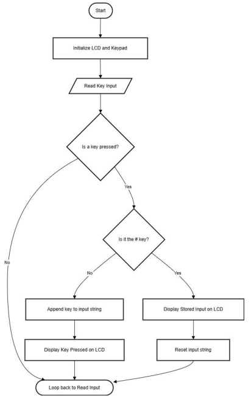
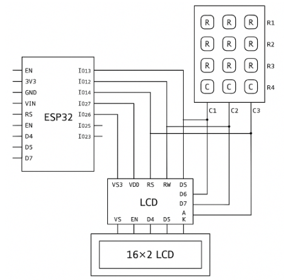
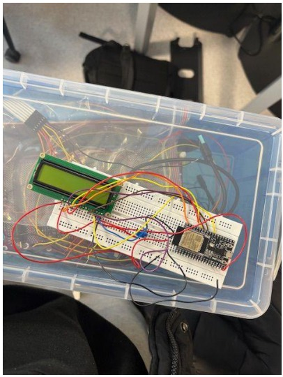

# ESP32 Keypad and LCD Interface — Documentation

This folder contains the original keypad input flowchart, circuit schematic, breadboard photograph and stripboard construction evidence from the ESP32 Keypad and LCD Interface laboratory project.

## 1. Keypad Input Flowchart

Original flowchart illustrating keypad input detection, character storage, LCD feedback and the input-confirmation process.

The `#` key is used to confirm the stored input before the program clears the string for a new entry.

## 2. Keypad and LCD Circuit Schematic

Original Fritzing schematic showing the ESP32 connections to the 4×3 matrix keypad and 16×2 LCD.

The LCD uses a 4-bit parallel interface, while the keypad connects through four row pins and three column pins.

## 3. Keypad and LCD — Breadboard Construction

Original laboratory photograph showing the keypad and LCD interface assembled on a breadboard.

The breadboard prototype was used to test keypad input detection and LCD display functionality before further hardware construction.

## 4. Keypad and LCD — Stripboard Construction

Original laboratory photograph showing the keypad and LCD interface assembled on stripboard.

The interface was successfully tested initially, although later hardware connection problems prevented integration into the complete maze-navigation system.

## Notes

- All diagrams and photographs document the original university laboratory work.
- The system uses an ESP32 microcontroller with a 4×3 matrix keypad and 16×2 LCD.
- The keypad processes individual character inputs and stores them in a string.
- The LCD displays keypad input and the stored sequence when the `#` key is pressed.
- The completed input is also sent to the Arduino Serial Monitor.
- The later command-based maze-navigation system was not successfully completed and is not presented as an operational feature.

For the full project description, pin configurations and Arduino sketch, return to the [main README](../README.md).
