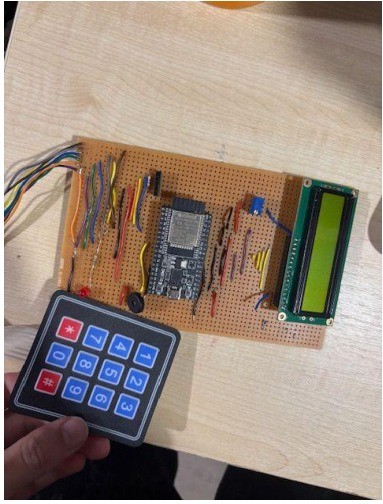

# ESP32 Keypad and LCD Interface — Documentation

Original diagrams and laboratory photographs from **Week 7, Figures 6–9**, of the Electrical and Electronic Engineering laboratory report.

## 1. Keypad Input Flowchart

Figure 6: The program waits for a keypress, displays and stores ordinary keys, and displays the stored input when `#` is pressed before resetting the input string.

## 2. Keypad and LCD Schematic

Figure 7: The original report schematic of the ESP32, 4×3 keypad and 16×2 LCD. The report specifies LCD GPIOs 4, 5, 18, 19, 21 and 23, with keypad rows 13, 12, 14 and 27 and columns 26, 25 and 33. See the Arduino sketch for the exact pin order.

## 3. Breadboard Implementation

Figure 8: Photograph of the laboratory breadboard prototype, including the ESP32, LCD and connecting wires.

## 4. Stripboard Implementation

Figure 9: Photograph of the assembled stripboard with the ESP32, keypad and LCD.

## Notes

These images document the **tested keypad/LCD interface**. The later maze-navigation command system was not successfully completed and is not represented as operational here.

Return to the [main README](../README.md) for project details and source code.
